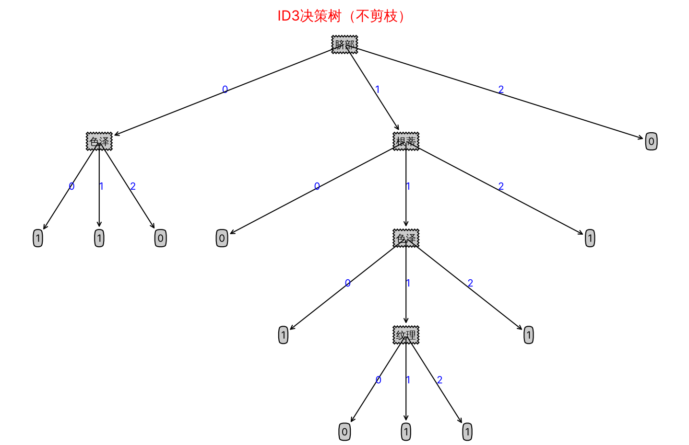
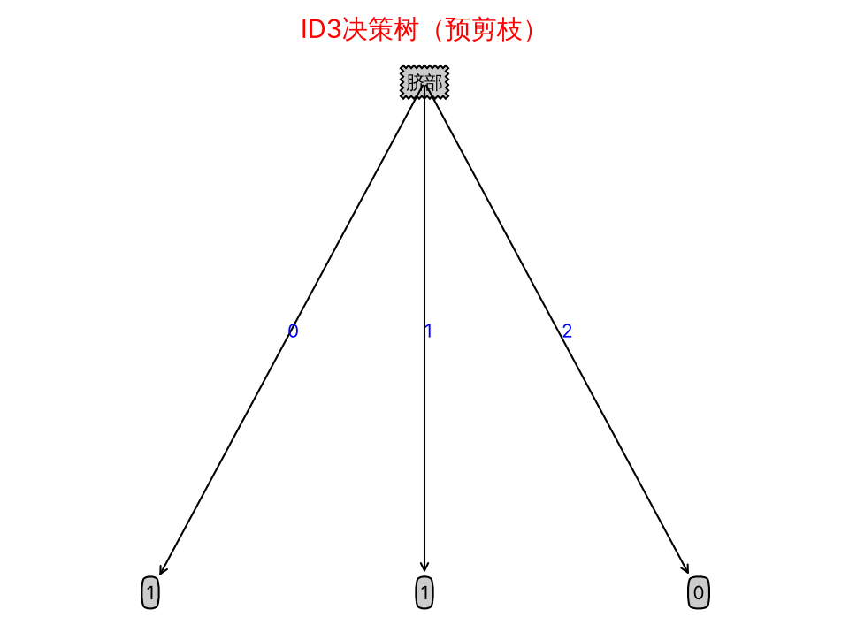
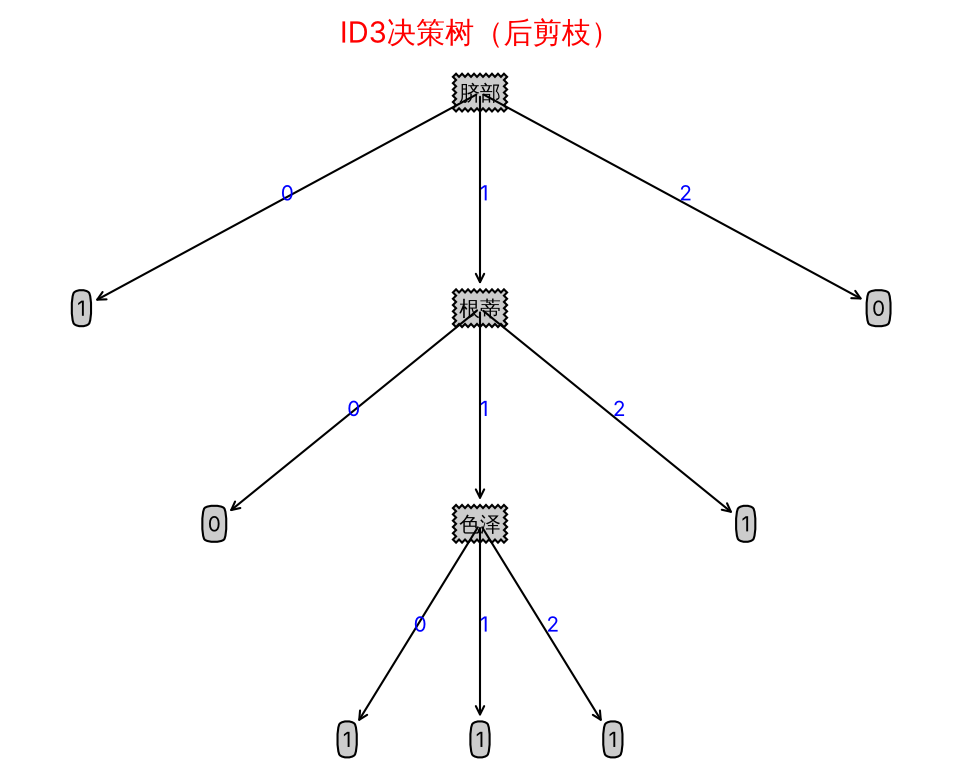
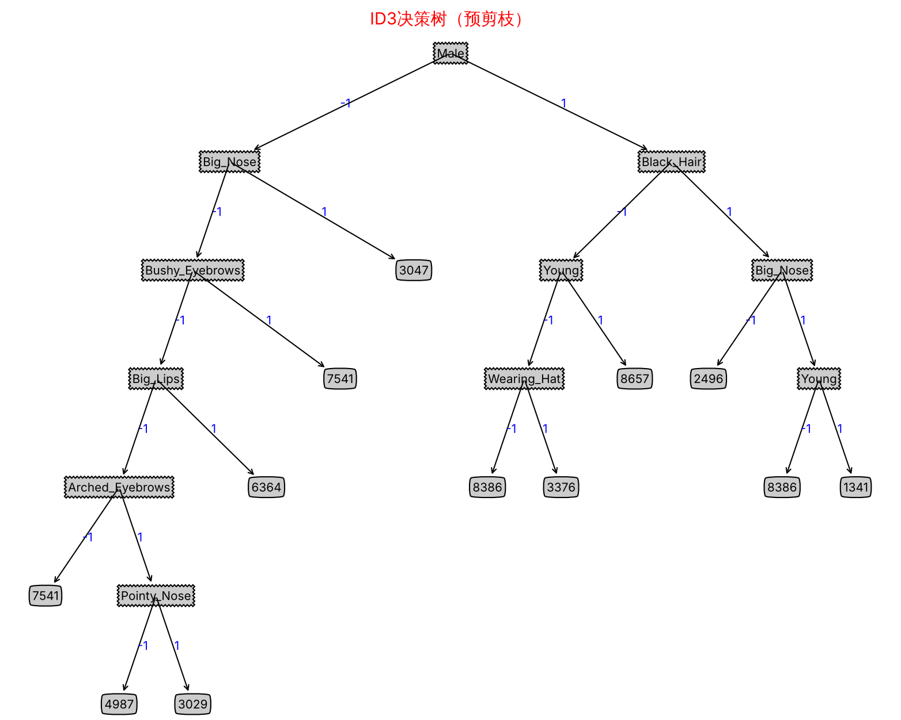
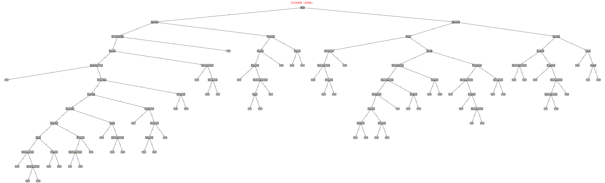
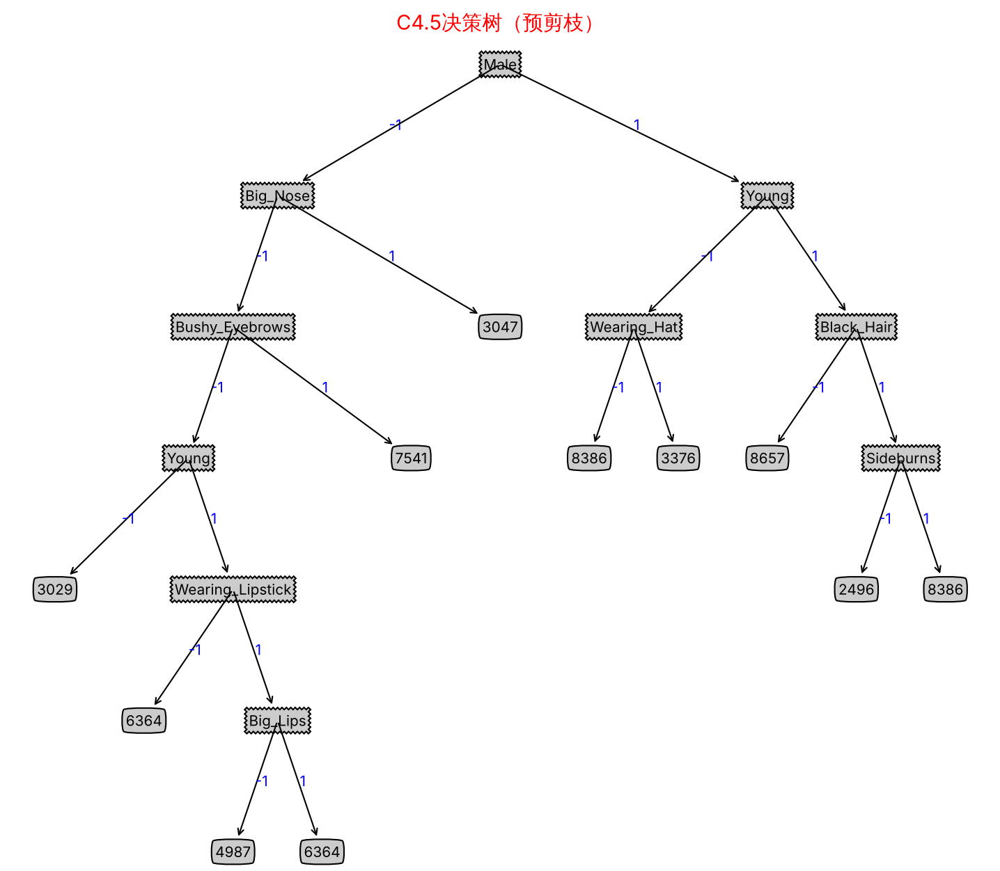
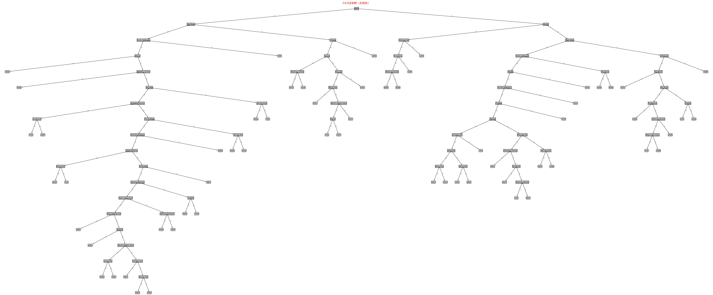

# 模式识别与机器学习 · 编程作业 #2：决策树

**学号：** ____________　　**姓名：** ____________

---

## 1. 实现说明

所有 TODO 都在 `code/tree.py` 中补全。为了能批量运行、保存图片，另外对 `code/treePlotter.py` 做了少量修改。

### 1.1 特征选择准则

设当前数据集为 D，第 k 类样本所占比例为 p<sub>k</sub>；特征 a 有 V 个取值，D<sup>v</sup> 为 a=v 的子集。

| 函数 | 准则 | 公式 |
|---|---|---|
| `cal_entropy` | 信息熵 | Ent(D) = −Σ<sub>k</sub> p<sub>k</sub> log<sub>2</sub> p<sub>k</sub> |
| `ID3_chooseBestFeatureToSplit` | 信息增益 | Gain(D,a) = Ent(D) − Σ<sub>v</sub> (\|D<sup>v</sup>\|/\|D\|)·Ent(D<sup>v</sup>) |
| `C45_chooseBestFeatureToSplit` | 增益率 | Gain_ratio(D,a) = Gain(D,a) / IV(a)，IV(a) = −Σ<sub>v</sub> (\|D<sup>v</sup>\|/\|D\|)·log<sub>2</sub>(\|D<sup>v</sup>\|/\|D\|) |
| `CART_chooseBestFeatureToSplit`（选做） | 基尼指数 | Gini_index(D,a) = Σ<sub>v</sub> (\|D<sup>v</sup>\|/\|D\|)·(1 − Σ<sub>k</sub> p<sub>k,v</sub><sup>2</sup>) |

ID3、C4.5 选准则值**最大**的特征，CART 选基尼指数**最小**的特征。

C4.5 有一个特殊情况：某特征在当前节点只有一个取值时，IV(a)=0，直接相除会除零。这种特征本来就不能划分数据，所以把它的增益率记为 0。

### 1.2 建树与剪枝

* **建树（`createTree`）**：调用传入的 `chooseBestFeatureToSplit` 得到最优特征下标 `bestFeat` 和特征名 `bestFeatLabel`，然后对该特征的每个取值递归建子树。
* **预剪枝**：在划分**之前**，比较两种情况在验证集上的准确率：
  * 不划分：当前节点作为叶节点，输出训练样本的多数类；
  * 划分：每个分支作为叶节点，输出该分支训练样本的多数类（`Counter(...).most_common(1)`）。

  如果划分后的准确率 ≤ 划分前的准确率，就不划分。
* **后剪枝**：递归会先把子树建完，所以剪枝判断是**自底向上**进行的。每个节点上，比较两种情况在落入该节点的验证样本上的准确率：
  * 保留整棵子树；
  * 把子树替换为叶节点，输出该节点训练样本的多数类（`post_prune_output`）。

  只有剪枝后准确率**严格更高**时才剪。

> 说明：框架用 `test.txt` 作为剪枝时的验证集。因此剪枝后报告的测试准确率是在剪枝时“看过”的数据上得到的，会偏乐观。这是框架本身的设定，本报告沿用不变。

### 1.3 对框架的补充与修正

1. **样本属性全相同时停止划分。** 对应西瓜书图 4.2 的第 2 种终止情形。CelebA 中有些节点里的样本，40 个属性取值完全相同，但身份不同。这时所有特征的增益都是 0，原框架会用 `>=` 一直选最后一个特征，每次只产生一个非空分支，最后形成深度 40 的“单链”。加上这个判断后：
   * 测试准确率完全不变；
   * ID3 不剪枝的树从 99 个叶节点、深度 40，缩小到 67 个叶节点、深度 12。
2. **预剪枝时验证集为空。** 原代码在计算 `cal_acc` 时会除以 0。现在按照“划分后准确率 ≤ 划分前就不划分”的规则，直接返回多数类叶节点。
3. **最优特征下标为 −1 时的保护。** 浮点误差可能使所有增益都略小于 0，导致最优特征下标为 −1。这种情况下直接返回叶节点。
4. **运行与可视化：**
   * 剪枝方式改为由命令行第 3 个参数指定（`none / pre / post`）；
   * 没有图形界面时自动使用 Agg 后端，把图片保存到 `code/results/`；
   * 画布大小按叶节点数自适应；
   * 依次尝试多种中文字体（SimHei / 微软雅黑 / 文泉驿 / Noto CJK）；
   * 支持整棵树被剪成单个叶节点的情况。

### 1.4 运行方法

```bash
cd code
pip install matplotlib
python tree.py melon 1 none     # 数据集 算法(1=ID3,2=C4.5,3=CART) 剪枝(none/pre/post)
./run_all.sh                    # 一次跑完 2 个数据集 × 3 种算法 × 3 种剪枝
```

输出位置：

* 图片：`code/results/<数据集>_<算法>_<剪枝>.png`
* 完整日志（每个节点各特征的准则值、预测结果）：`code/results/logs/`
* 汇总：`code/results/summary.txt`

---

## 2. 实验结果

### 2.1 melon 数据集（ID3）

训练集 10 个样本，测试集 7 个样本，4 个特征（纹理、根蒂、色泽、脐部）。Ent(D)=1.0。根节点处各特征的信息增益如下：

| 特征 | 纹理 | 根蒂 | 色泽 | 脐部 |
|---|---|---|---|---|
| 信息增益 | 0.174 | 0.115 | 0.275 | **0.275** |

色泽和脐部的增益并列最大。框架用 `>=` 更新最优值，所以选下标靠后的**脐部**作为根节点。

| ID3 | 叶节点数 | 深度 | 训练准确率 | 测试准确率 |
|---|---|---|---|---|
| 不剪枝 | 11 | 4 | 100% | 42.86%（3/7） |
| 预剪枝 | 3 | 1 | 70% | **71.43%**（5/7） |
| 后剪枝 | 7 | 3 | 80% | **71.43%**（5/7） |

**不剪枝：**



**预剪枝：**



预剪枝只保留了根节点“脐部”的一次划分。

**后剪枝：**



后剪枝剪掉了以下两部分，保留了“脐部 → 根蒂 → 色泽”这条主干：

* “脐部=0”分支下的“色泽”子树；
* 最深一层的“纹理”子树。

### 2.2 CelebA 子集（ID3 / C4.5）

训练集 250 个样本，测试集 50 个样本，40 个二值属性，10 个身份类别。三种算法选出的根节点都是 **Male**（性别）。

| 算法 | 剪枝 | 叶节点数 | 深度 | 训练准确率 | 测试准确率 |
|---|---|---|---|---|---|
| ID3 | 不剪枝 | 67 | 12 | 99.6% | 78% |
| ID3 | 预剪枝 | 12 | 6 | 76.4% | 76% |
| ID3 | 后剪枝 | 57 | 12 | 93.6% | **86%** |
| C4.5 | 不剪枝 | 73 | 18 | 99.6% | 72% |
| C4.5 | 预剪枝 | 11 | 6 | 67.6% | 68% |
| C4.5 | 后剪枝 | 60 | 18 | 93.2% | **84%** |
| CART（选做） | 不剪枝 | 68 | 14 | 99.6% | 80% |
| CART（选做） | 预剪枝 | 11 | 6 | 76.0% | 76% |
| CART（选做） | 后剪枝 | 64 | 14 | 98.4% | **84%** |

注：

* 叶节点数包含没有训练样本的空分支叶节点，这些叶节点输出父节点的多数类。
* 训练准确率达不到 100%，原因是有样本的属性完全相同但身份不同，任何决策树都无法区分它们。

**ID3 + 预剪枝：**



**ID3 + 后剪枝：**



**C4.5 + 预剪枝：**



**C4.5 + 后剪枝：**



后剪枝的树比较大。原图分辨率较高，可以在 `code/results/` 中打开放大查看。不剪枝和 CART 的图也在同一目录下。

---

## 3. 分析

### 3.1 ID3 与 C4.5

| | ID3（信息增益） | C4.5（增益率） |
|---|---|---|
| 准则 | 划分后不确定性减少了多少 | 信息增益除以特征本身的“固有值” IV(a) |
| 偏好 | 偏好**取值多**的特征。取值越多，每个子集越“纯”，增益越大，极端情况下会选“编号”这类特征 | 用 IV 惩罚取值多的特征，但反过来偏好 **IV 小**的特征，也就是取值少、或划分**很不均衡**的特征 |
| 实际做法 | — | 原始 C4.5 用启发式：先从增益高于平均水平的特征中筛选，再从中选增益率最高的。本作业按要求只用增益率 |

**实验中的体现：**

* **CelebA 的特征全部是二值的**，所以 ID3 偏好多值特征的问题不会出现。这时增益率反而带来副作用。对二值特征，IV(a) 就是划分比例的熵：
  * 正负样本各占一半时，IV(a)=1；
  * 划分很不均衡时（比如 *Bald*、*Wearing_Hat* 这种只有少数样本为 1 的属性），IV(a) 很小，增益率被放大。

  所以 C4.5 更爱选“切下一小撮样本”的属性。结果是：
  * C4.5 的树更深（18 层，ID3 为 12 层）、叶节点更多（73 个，ID3 为 67 个）；
  * 不剪枝时，C4.5 的测试准确率（72%）低于 ID3（78%）；
  * 预剪枝后，C4.5 只有 68%，也低于 ID3 的 76%。
* **melon 数据集**的情况相反：C4.5 不剪枝的测试准确率（71%）高于 ID3（43%）。但测试集只有 7 个样本，1 个样本就差 14%。两者的差别主要来自“脐部=0”分支：
  * 在这个分支里，三个特征的信息增益都是 0.811，ID3 按 `>=` 选了色泽；
  * C4.5 中，色泽在该分支有 3 个取值，IV 更大，增益率只有 0.541；纹理和根蒂的增益率并列为 1.000，按 `>=` 选了根蒂。

  这正好体现了增益率对“取值多”特征的惩罚。但并列时的选择取决于特征顺序，测试样本又极少，所以这个差别不能说明 C4.5 更好。
* **总结：**
  * 特征取值数差别大时（例如包含 ID、日期这类特征），C4.5 明显优于 ID3；
  * 特征都是二值、取值数相同时，增益率的归一化没有必要，还会引入偏好不均衡划分的偏差，ID3 和 CART 反而更稳定；
  * 本实验中 CART 不剪枝的准确率最高（80%）。

### 3.2 预剪枝与后剪枝

| | 预剪枝 | 后剪枝 |
|---|---|---|
| 时机 | 建树过程中，**划分之前**就判断 | 先生成完整的树，再**自底向上**判断 |
| 树规模 | 很小（melon 3 个叶节点；CelebA 11~12 个叶节点、深度 6） | 较大，保留了更多分支（melon 7 个；CelebA 57~64 个） |
| 训练时间 | 短。很多分支根本不展开 | 长。要先建完整的树，再逐个节点评估 |
| 过拟合 | 能有效抑制 | 能有效抑制 |
| 欠拟合风险 | **高**。它是“贪心”的：当前划分没有提升，不代表后续划分没有提升，但预剪枝会直接放弃 | **低**。看到完整子树之后才决定，不会误杀“先无用、后有用”的划分 |
| 本实验测试准确率 | melon 71%；CelebA：ID3 76%，C4.5 68% | melon 71%；CelebA：ID3 **86%**，C4.5 **84%** |

**实验中的体现：**

* **melon 数据集：** 不剪枝的树完全拟合了训练集（100%），但测试集只有 43%，是典型的过拟合。两种剪枝都把测试准确率提高到 71%，而预剪枝得到的树小得多。
* **CelebA 数据集：** 预剪枝明显欠拟合。
  * 训练准确率只有 68%~76%，测试准确率比不剪枝还低：ID3 从 78% 降到 76%，C4.5 从 72% 降到 68%。
  * 原因：区分 10 个身份需要多个属性**组合**起来判断，单独看某一次划分，可能暂时不提升验证准确率。预剪枝的贪心策略因此过早停止。
* **后剪枝在三种算法上都是最好的**（84%~86%）：
  * ID3：78% → 86%，叶节点 67 → 57；
  * C4.5：72% → 84%，叶节点 73 → 60；
  * CART：80% → 84%，叶节点 68 → 64。

  这与西瓜书的结论一致：后剪枝通常比预剪枝保留更多分支，欠拟合风险更小，泛化性能往往更好，但训练开销更大。
* **深度没有变化：** 后剪枝后树的深度不变（ID3 仍为 12）。原因是框架只在“剪枝后验证准确率**严格提高**”时才剪；验证集只有 50 个样本，很多深层节点根本没有验证样本落入，按规则保留不剪。

### 3.3 局限

* 验证集和测试集是同一份数据，剪枝后的测试准确率偏乐观。更严谨的做法是从训练集中再划出一部分作为验证集。
* CelebA 测试集只有 50 个样本，1 个样本对应 2% 的准确率，算法之间几个百分点的差距不一定显著。
* 预剪枝的判断条件用 `<=`（准确率不提升就不划分），后剪枝的判断条件用 `>`（严格提升才剪）。这两个设定都偏向更小的树，对预剪枝的影响更大。
